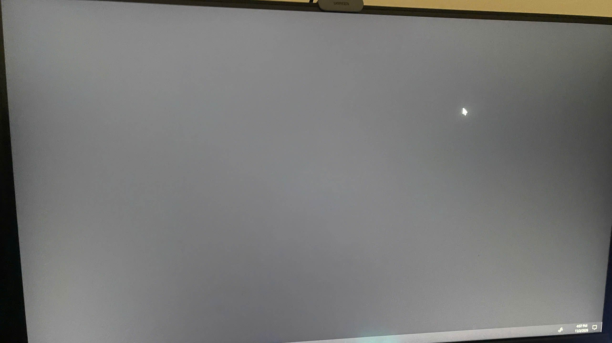

# Win Explorer AutoFix

A lightweight, background utility designed to detect and resolve Windows 10 and Windows 11 shell initialization failures (black screen at logon) caused by unresponsive `explorer.exe` instances.

[](https://github.com/Bravee9/black-screen-windows-10-11-fix/releases/latest)
[](https://github.com/Bravee9/black-screen-windows-10-11-fix)
[](https://github.com/Bravee9/black-screen-windows-10-11-fix)
[](LICENSE)

<p align="center">
  
  
</p>
<p align="center">
  <em>Figure 1: Hardware monitor capture of logon black screen failure (left) and system shell hang state (right).</em>
</p>

---

## Downloads

Direct download links for the latest stable build:

| Package | Format | Target Audience | Direct Link |
| :--- | :---: | :--- | :--- |
| **Installer** | `.exe` | Standard users. Provides a setup wizard and integrates with Windows Installed Apps for clean removal. | [Download WinExplorerAutoFix-Setup.exe](https://github.com/Bravee9/black-screen-windows-10-11-fix/releases/latest/download/WinExplorerAutoFix-Setup.exe) |
| **Portable** | `.zip` | Advanced users. Contains raw scripts and batch launchers for manual inspection and deployment. | [Download WinExplorerAutoFix-Portable.zip](https://github.com/Bravee9/black-screen-windows-10-11-fix/releases/latest/download/WinExplorerAutoFix-Portable.zip) |

All releases and release notes are available on the [GitHub Releases](https://github.com/Bravee9/black-screen-windows-10-11-fix/releases) page.

---

## Overview

### Problem Description
On certain Windows 10 and Windows 11 configurations, the primary desktop shell (`explorer.exe`) fails to complete its graphical user interface initialization during the user logon sequence. This failure manifests as a persistent black screen lacking the taskbar, system tray, and desktop icons. Typically, manual intervention via Task Manager (`Ctrl + Shift + Esc`) is required to restart `explorer.exe`.

### Solution Architecture
Win Explorer AutoFix automates shell health verification and recovery:
- **Intelligent Conditional Recovery**: Evaluates shell responsiveness via native Win32 APIs before performing any action. If the shell is operating normally, the utility terminates immediately without restarting Explorer or causing screen flicker.
- **Zero-UAC Requirement**: Deploys exclusively within user profile scope (`%LOCALAPPDATA%` and the user startup directory), requiring no elevated administrative privileges.
- **Pure Native Execution**: Built entirely using native PowerShell and .NET platform invoke (P/Invoke) mechanisms, eliminating dependencies on legacy VBScript or MSHTA components and ensuring forward compatibility with Windows 11 24H2+.
- **Process State Verification**: Confirms complete termination of hung processes before relaunching the shell, followed by a secondary verification step.

---

## Detection Mechanism

The recovery script (`core/fix.ps1`) performs the following sequential checks before executing any remediation:

1. **Process Presence**: Verifies whether an active `explorer.exe` process exists in the current session.
2. **Thread Responsiveness**: Checks the `Responding` status of all active `explorer.exe` process threads.
3. **Window-Level Inspection**:
   - Queries `user32.dll!FindWindow` for the primary taskbar class `Shell_TrayWnd`. If this window is absent after the initialization delay, initialization failure is confirmed.
   - Queries `user32.dll!IsHungAppWindow` against the taskbar window handle to detect unresponsive message loops.
4. **Conditional Execution**: Recovery is initiated only if an anomaly is detected or if `forceRestart` is explicitly enabled.

---

## Installation

### Method 1: Executable Installer (Recommended)
1. Download `WinExplorerAutoFix-Setup.exe`.
2. Run the executable and proceed through the installation wizard.
3. If prompted by Windows Defender SmartScreen, select **More info** followed by **Run anyway**.

The installer places runtime components into `%LOCALAPPDATA%\AutoFixExplorer` and registers a startup launcher shortcut.

### Method 2: Manual / Portable
1. Download and extract `WinExplorerAutoFix-Portable.zip`.
2. Execute `Install.bat`.

---

## Configuration

Operational parameters can be adjusted via `%LOCALAPPDATA%\AutoFixExplorer\config.json`:

```json
{
  "initialDelaySeconds": 5,
  "forceRestart": false
}
```

- `initialDelaySeconds` (integer, default: `5`): Delay in seconds allocated for system initialization before running diagnostics. Lower values (e.g., `3`) may be used on high-speed NVMe drives; higher values (e.g., `8-10`) are recommended for mechanical hard drives.
- `forceRestart` (boolean, default: `false`): When set to `true`, forces an unconditional restart of `explorer.exe` at logon regardless of diagnostic results.

---

## Uninstallation

- **Installed via `.exe`**: Open Windows **Settings** > **Apps** > **Installed apps**, locate **Win Explorer AutoFix**, and select **Uninstall**.
- **Installed via `.zip`**: Run `Uninstall.bat` from the extracted directory.

---

## Project Structure

```text
black-screen-windows-10-11-fix/
├── .github/
│   └── workflows/
│       └── release.yml        # Automated release build workflow
├── core/
│   ├── fix.ps1                # Core diagnostics and recovery script
│   ├── config.json            # Runtime configuration file
│   ├── install.ps1            # Native installation logic
│   └── uninstall.ps1          # Cleanup and removal logic
├── images/
│   ├── sample.png             # System shell hang symptom preview
│   └── sample_1.jpg           # Hardware monitor capture of startup failure
├── build.ps1                  # Release build script
├── installer.iss              # Inno Setup compilation definition
├── Install.bat                # Standalone installation launcher
├── Uninstall.bat              # Standalone uninstallation launcher
├── README.md                  # Documentation
└── LICENSE                    # MIT License
```

---

## Building from Source

Requirements:
- Windows 10 or 11
- PowerShell 5.1 or later
- Inno Setup 6 (optional, required only for `.exe` compilation)

To build both the installer and portable archive, execute:

```powershell
powershell -ExecutionPolicy Bypass -File .\build.ps1
```

Generated assets will be placed in the `release/` directory.

---

## License

This project is licensed under the MIT License. See [LICENSE](LICENSE) for details.
